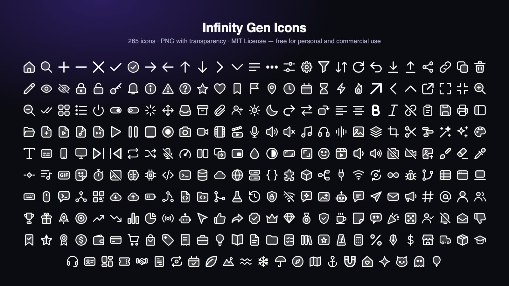

# Infinity Gen Icons

**265 free icons** — white, on a transparent background, in **SVG** (vector, sharp on any screen) and compact **PNG8**. Ready for dark UIs, videos, slides and apps.
Released under the **MIT License**: use them in personal and commercial projects, modify and redistribute them freely.

## Download

- **All icons (ZIP):** [infinity-gen-icons.zip](https://github.com/leoerdman/Infinity-Gen-Icons/releases/latest/download/infinity-gen-icons.zip)
- **Browse, search and download one by one:** [https://leoerdman.github.io/Infinity-Gen-Icons/](https://leoerdman.github.io/Infinity-Gen-Icons/)
- Or clone: `git clone https://github.com/leoerdman/Infinity-Gen-Icons.git`

## What's inside

| Category | Icons |
|---|---|
| UI | 86 |
| Media | 55 |
| Tech | 40 |
| Social | 38 |
| Business | 32 |
| Symbols | 14 |

- `svg/` — vector icons, one SVG per icon (white fill, two-tone: solid outline + 20 % fill). Scale to any size.
- `icons/` — the same icons as PNG8 (indexed palette with transparency, about 256 px tall).
- `icons.json` — the list of all icons: `id`, `file` (PNG), `svg`, `category`, English `name`, Russian keywords `ru`, size and `sha256` / `svg_sha256`.
- `tools/build.py` — rebuilds `svg/` from the PNGs (potrace) and compresses PNGs to PNG8 (pngquant).
- `index.html` — the gallery page with search.

## License

[MIT](LICENSE) © 2026 Infinity Gen. You can use, copy, modify, merge, publish, distribute, sublicense and sell copies.
Keep the license notice when you redistribute the pack itself; attribution in your project is appreciated but not required.

---

## По-русски

**Infinity Gen Icons** — 265 бесплатных иконок: белые, на прозрачном фоне, в **SVG** (вектор — чётко на любом экране) и лёгком **PNG8**. Для тёмных интерфейсов, роликов, презентаций и приложений.

Лицензия **MIT**: иконками можно пользоваться в личных и коммерческих проектах, менять их и распространять.
При раздаче самого пака сохраните файл `LICENSE`; ссылка на нас в вашем проекте — по желанию.

- **Скачать весь пак (ZIP):** [infinity-gen-icons.zip](https://github.com/leoerdman/Infinity-Gen-Icons/releases/latest/download/infinity-gen-icons.zip)
- **Смотреть, искать и скачивать по одной:** [https://leoerdman.github.io/Infinity-Gen-Icons/](https://leoerdman.github.io/Infinity-Gen-Icons/)
